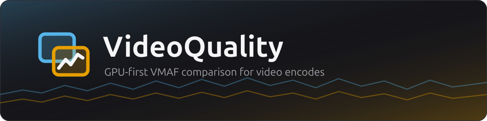
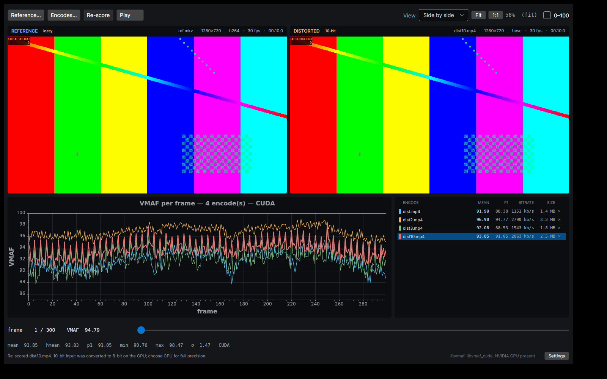
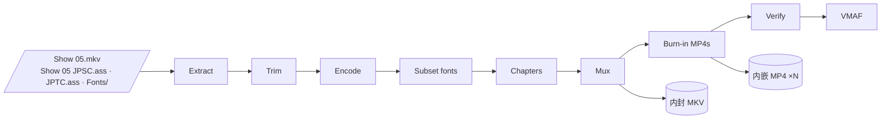
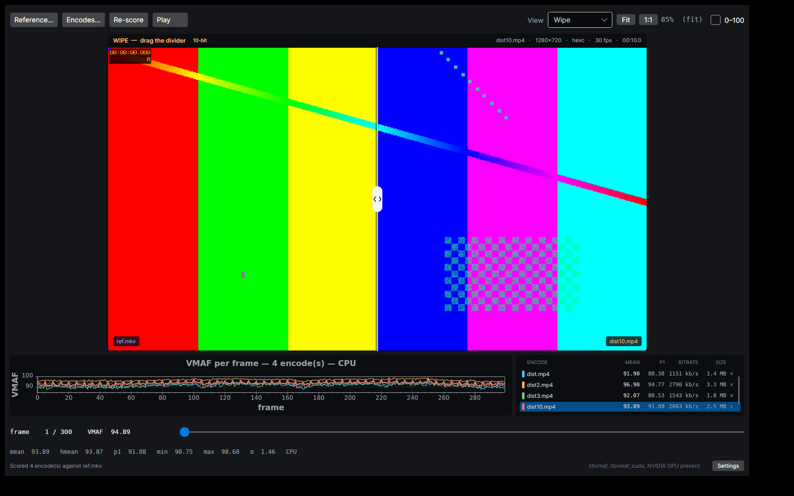
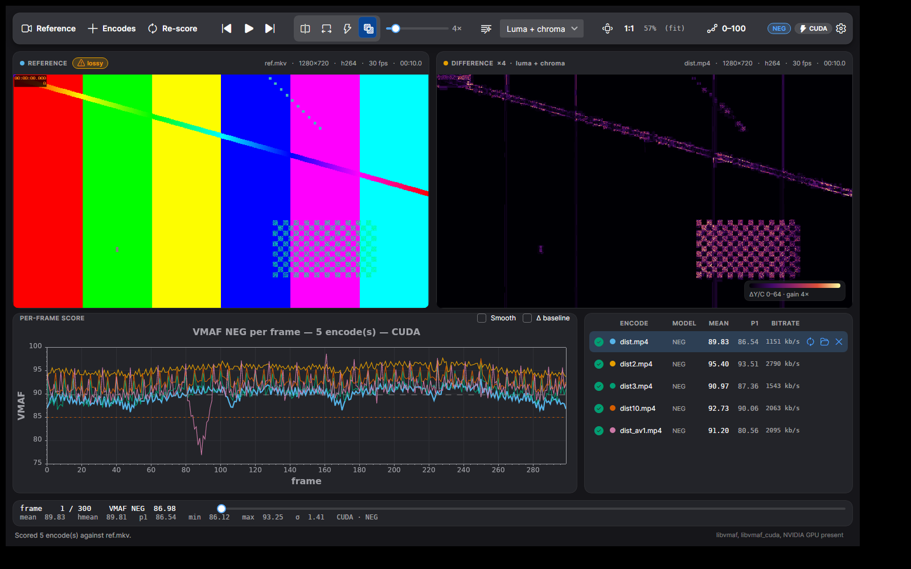
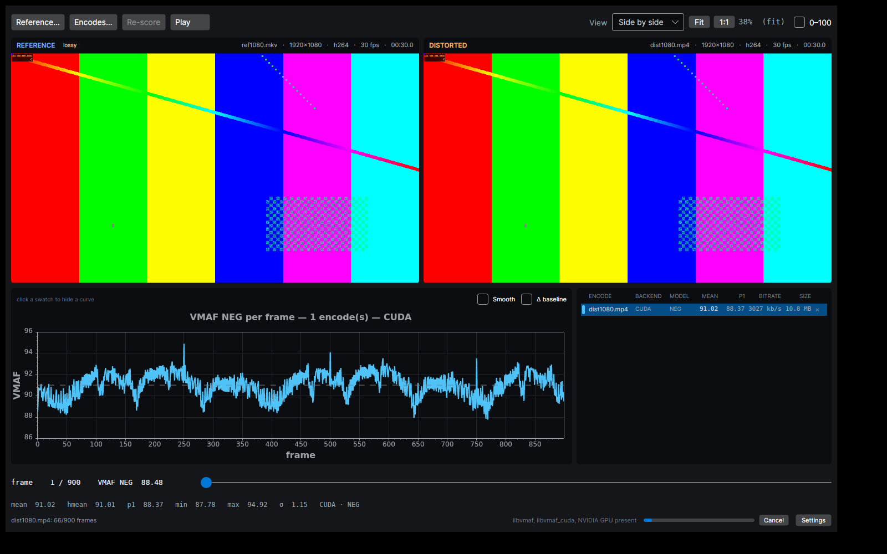
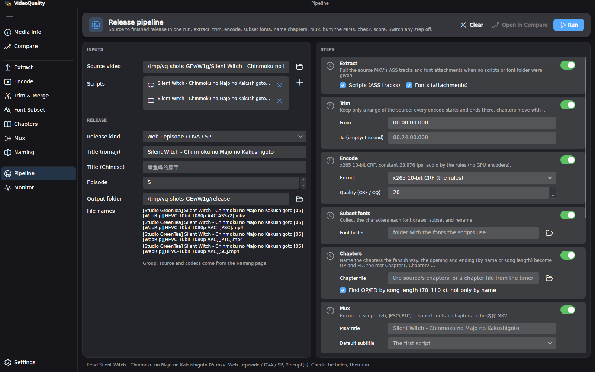
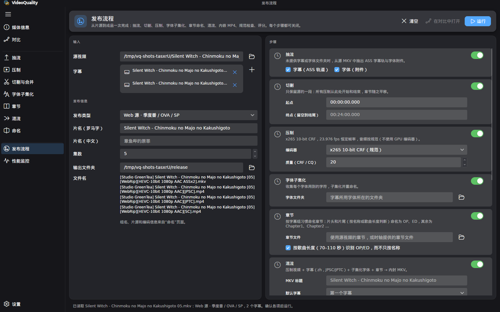
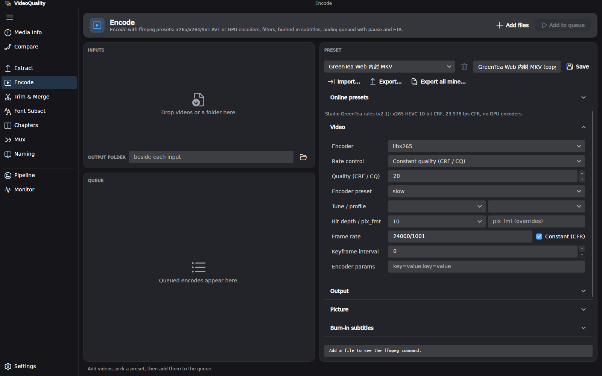
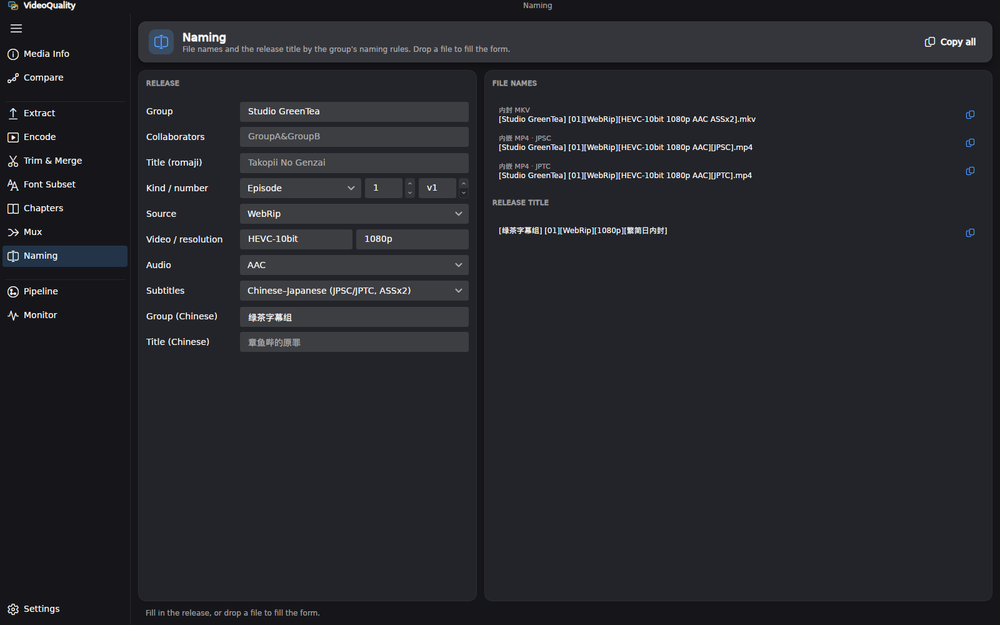

<p align="center">
  
</p>

<p align="center">
  <a href="https://github.com/SeaAndStars/VideoQuality/releases"></a>
  
  
  
  
  
  <a href="LICENSE"></a>
</p>

<p align="center">
  <b>Score encodes against a reference with VMAF on the GPU, then see exactly where they differ.</b><br>
  Per-frame curves for many encodes at once, a frame-exact synced viewer, and a difference heatmap,<br>
  plus a release toolkit that takes an anime episode from its source to a finished release in one run.
</p>

<p align="center">
  <a href="#download">Download</a> ·
  <a href="#features">Features</a> ·
  <a href="#release-pipeline">Pipeline</a> ·
  <a href="#build-from-source">Build</a> ·
  <a href="#command-line">CLI</a> ·
  <a href="docs/usage.md">Docs</a>
</p>

<p align="center">
  
</p>

## Features

**Scoring**
- **GPU-first VMAF.** Every score runs through `libvmaf_cuda` when the GPU and ffmpeg allow it, with
  automatic CPU fallback. Two GPU scores run at once (900 frames of 1080p in about 1.6 s on an
  RTX 5060 Ti).
- **VMAF NEG by default**, so sharpening and contrast tricks do not buy points. Standard and 4K
  models are one click away, and mixing models in one comparison is flagged.
- **Pooled stats that matter:** mean, harmonic mean, p1, min, max and σ, plus the *true* video
  bitrate from the packet index (no audio or container overhead).

**Comparing**
- **Many encodes, one reference.** Overlaid per-frame curves in a colourblind-safe palette, a table
  with mean, p1 and bitrate, Δ-to-baseline and smoothing.
- **Frame-exact viewer:** side by side, **wipe** with a draggable divider, A/B **flicker**, or an
  amplified **difference** heatmap with luma/chroma channels and auto gain. Zoom and pan stay locked
  across panes.
- **Fast stepping:** ←/→ steps, scrubs and plays smoothly thanks to a keyframe walk that skips
  frames nobody sees and a byte-budgeted frame cache
  ([benchmarks](docs/development.md#benchmarks)).

**Release toolkit** (left navigation, grouped as inspect · make · automate)
- **Media Info.** What a file holds (streams, languages, flags, attachments, chapters) and a check
  against the group's release rules (codec, bit depth, frame rate, audio, track names, size).
- **Encode (压制).** A preset-driven ffmpeg queue in the spirit of
  [FFmpegFreeUI](https://github.com/Lake1059/FFmpegFreeUI): x264, x265, SVT-AV1 and NVENC/QSV/AMF;
  CRF, QP, bitrate, two-pass and target size; scaling, cropping, deinterlacing, denoise, colour tags,
  burned-in subtitles, audio and stream options, custom arguments and a live command preview.
  Jobs show progress, speed, ETA and the projected size, and can be paused, stopped and retried.
  Built-in presets follow the group's rules (x265 10-bit, the size per 24 minutes, AAC or FLAC), plus
  a measured **NVENC HEVC UHQ** preset. Presets import and export as JSON and download from any GitHub
  folder ([`presets/`](presets/README.md) by default).
- **Trim & Merge (切割/合并).** Cut by time with stream copy (with a keyframe warning) or a
  frame-exact re-encode; join files with mkvmerge's append or ffmpeg's concat, after a
  compatibility check.
- **Font Subset.** Our own ASS font subsetter on HarfBuzz: collects every character each font draws
  (`\fn`, `\b`, `\i`, `\r`, vertical `@` fonts), matches faces the way renderers do, subsets and renames
  them to stable 8-character families, rewrites the scripts and verifies every glyph survived.
- **Chapters.** Import from a video or a chapter file, name OP/ED/Chapter*N*, check the marks, save
  Matroska XML or OGM, and send them to Mux.
- **Extract (抽流).** Pick tracks, embedded fonts and chapters and pull them out with `mkvextract`;
  MP4 and other containers are remuxed first.
- **Mux (混流).** Video, audio, scripts, a fonts folder and chapters into one MKV with per-track
  language, name, default and forced flags, named the group's way (`ja` audio, `zh` JPSC/JPTC/SC/TC
  subtitles) or generically.
- **Naming.** Release file names and titles from a form, a release name or a video's properties.
- **Release pipeline.** Every tool above as a step of one run, each with its own settings and an
  on/off switch, filled in from the source on drop. [More below](#release-pipeline).
- **Monitor.** CPU, memory and NVIDIA GPU load (encoder/decoder/VRAM) and each running encode.
- Encoding uses a separate **GPL ffmpeg** run as its own process (`tools/ffmpeg-encode/`, a pinned
  BtbN build with its source attached to each release); the app itself links only the LGPL libav.
  Extract and Mux run [MKVToolNix](https://mkvtoolnix.download)'s `mkvmerge`/`mkvextract`, bundled
  in `tools/mkvtoolnix/` (unmodified upstream 97.0 binaries, checksum-pinned; GPL-2.0, with the
  source attached to each release). Folders set in Settings take precedence.

**Workflow**

- **Drag and drop with explicit roles.** Drop on *Reference* or *Compare* (or anywhere for the
  automatic rule). Folders, paste, startup arguments and "Open With" follow the same rules.
- **Live job queue.** Rows appear immediately and move through probe → index → score, with per-row
  progress, re-score, reveal-in-folder and remove.
- **Honest about what it did:** backend and precision (`CUDA·8b` when a 10-bit source was converted
  on the GPU), colour metadata warnings, resolution/fps/frame-count mismatch warnings, and a session
  log.
- **English and 简体中文.** Every UI text comes from a translation catalog
  (`VideoQuality.Core/Localization/*.json`); pick the language in Settings or follow the system.
  A change applies at once to every page, with no restart and nothing lost.
- **Portable.** On Windows the release is one `VideoQuality.exe` with ffmpeg bundled, and settings
  live in `settings.json` beside it.

## Release pipeline

Drop an episode on **Pipeline** and run. The page reads the scripts, fonts and chapters beside the
source, the title and episode from its file name, and whether it is a BD or web release; then one run
makes the 内封 MKV and the 内嵌 MP4s and checks them against the group's rules.



- **Every step can be changed:** pull scripts/fonts out of the source, cut a range, encode with
  x265, NVENC UHQ or any Encode preset, pick the font folder and chapter file, name OP/ED/Chapter*N*,
  set the MKV title and default subtitle, choose which MP4s to burn (any number, any script, JPSC /
  JPTC / SC / TC), stop on rule failures or only report them, pick the VMAF model and reference.
- **NVENC UHQ at CQ 26.25** matched x265 CRF 18's size on a 24-minute episode with higher VMAF on
  every statistic (NEG 95.31 vs 95.10, p1 92.19 vs 91.18, min 83.6 vs 77.0).

See the [pipeline guide](docs/pipeline.md) for the inference rules, every step's settings and the
measurements.

## Screenshots

<table>
  <tr>
    <td width="50%"><br><sub><b>Wipe:</b> drag the divider between reference and encode.</sub></td>
    <td width="50%"><br><sub><b>Difference:</b> amplified error heatmap with auto gain.</sub></td>
  </tr>
  <tr>
    <td width="50%"><br><sub><b>Scoring:</b> per-row progress, two GPU jobs at a time.</sub></td>
    <td width="50%"><br><sub><b>Side by side:</b> five encodes, NEG model, CUDA backend.</sub></td>
  </tr>
  <tr>
    <td width="50%"><br><sub><b>Pipeline:</b> filled in from a dropped episode; every step has its own settings.</sub></td>
    <td width="50%"><br><sub><b>简体中文:</b> the same page; every text is translated.</sub></td>
  </tr>
  <tr>
    <td width="50%"><br><sub><b>Encode:</b> presets (built-in, saved, online), the editor and the queue.</sub></td>
    <td width="50%"><br><sub><b>Naming:</b> release file names and the release title.</sub></td>
  </tr>
</table>

## Download

**Windows 10/11 (x64):** grab `VideoQuality-<version>-win-x64.zip` from
[Releases](https://github.com/SeaAndStars/VideoQuality/releases), unzip anywhere, and run
`VideoQuality.exe`. Nothing else to install. For GPU scoring you need an NVIDIA GPU (Turing or newer)
and its driver; without one, scoring runs on the CPU.

```
VideoQuality.exe      the app (single file)
settings.json         your settings, created on first change
ffmpeg\               FFmpeg 9 + libvmaf 3.2.1 (CUDA), LGPL build, for decoding and scoring
tools\vq.exe          command-line tool
tools\ffmpeg-encode\  GPL ffmpeg for encoding (run as its own process)
tools\mkvtoolnix\     mkvmerge / mkvextract
licenses\             third-party notices
```

**Linux (x86-64):** grab `VideoQuality-<version>-linux-x64.tar.gz`, then:

```bash
tar -xzf VideoQuality-0.1.0-linux-x64.tar.gz
cd VideoQuality-0.1.0-linux-x64
./VideoQuality                    # run it
./install-desktop-entry.sh        # optional: add to the application menu and "Open With"
```

Same layout as Windows, with ffmpeg and libvmaf (CUDA) bundled. It runs on any distro with glibc 2.35
or newer (Ubuntu 22.04+, Debian 12+, Fedora 36+, …) and needs no extra packages; verified on a stock
Ubuntu 22.04. GPU scoring uses the NVIDIA driver you already have.

## Quick start

1. Drop a **reference** (lossless or high-bitrate is best) onto the left zone.
2. Drop one or more **encodes**, or a folder of them, onto the right zone.
3. Watch them score, then click a row to inspect it: step with ←/→, switch modes with the
   segmented control, hold <kbd>F</kbd> to flicker, scroll to zoom, drag to pan.

| Keys | Action |
|---|---|
| <kbd>←</kbd> / <kbd>→</kbd> (+ <kbd>Shift</kbd>) | step 1 (10) frames |
| <kbd>Space</kbd> | play / pause |
| <kbd>F</kbd> (hold) | flicker to the encode |
| <kbd>Ctrl</kbd>+<kbd>O</kbd> / <kbd>Ctrl</kbd>+<kbd>Shift</kbd>+<kbd>O</kbd> | open reference / add encodes |
| <kbd>Ctrl</kbd>+<kbd>V</kbd> | paste files or paths |
| <kbd>Ctrl</kbd>+<kbd>R</kbd> | re-score the selected encode |

## Build from source

Requirements: **.NET 10 SDK** and **FFmpeg 9.x** (`libavcodec.so.63` / `avcodec-63.dll`) built with
`--enable-libvmaf` (plus `libvmaf` with CUDA and `--enable-ffnvcodec` for GPU scoring, and
`--enable-libdav1d` for AV1 on the CPU path). The bindings are `FFmpeg.AutoGen` 9.0.1.1, and the app
refuses to start against a different libavcodec major.

```bash
git clone https://github.com/SeaAndStars/VideoQuality.git
cd VideoQuality
dotnet build VideoQuality.slnx

# reference first, then any number of encodes (or start empty and drop files)
dotnet run --project VideoQuality.App -- ref.mkv encode-a.mp4 encode-b.mp4
```

The app finds a VMAF-enabled ffmpeg automatically: a bundled `ffmpeg/` folder, `$VQ_FFMPEG`,
`ffmpeg` on PATH if it has libvmaf, `$FFMPEG_ROOT/bin`, `/opt/ffmpeg/bin`, or `C:\ffmpeg\bin`. The
resolved path is shown in **Settings**.

**Release packages.** The bundled FFmpeg is LGPL with `cuda-llvm`, so both releases are
redistributable. Windows is cross-compiled with mingw-w64. Linux is built in an Ubuntu 22.04
container for glibc 2.35 compatibility and self-tested:

```bash
./scripts/build-ffmpeg-windows.sh          # FFmpeg n9.0.2 + libvmaf v3.2.1 CUDA + dav1d → ~/build-win/stage
./scripts/build-ffmpeg-linux-docker.sh     # the same for Linux, in Docker            → ~/build-linux/stage
VQ_VERSION=0.1.0 ./scripts/package.sh win-x64      # → artifacts/VideoQuality-0.1.0-win-x64.zip
VQ_VERSION=0.1.0 ./scripts/package.sh linux-x64    # → artifacts/VideoQuality-0.1.0-linux-x64.tar.gz
```

## Command line

```bash
vq probe                                          # ffmpeg, libvmaf, CUDA and libav detection
vq score ref.mkv dist.mp4 --json out.json --csv out.csv [--gpu|--cpu] [--model vmaf_v0.6.1]
vq frame dist.mp4 42 --ppm frame.ppm              # decode one frame exactly as the viewer does
vq diag                                           # environment report for bug reports
vq subset JPSC.ass JPTC.ass --fonts Fonts --output out   # subset + rename fonts, rewrite scripts
```

From source, replace `vq` with `dotnet run --project VideoQuality.Cli --`.

## Performance

Measured with the BenchmarkDotNet suite in `VideoQuality.Benchmarks` (Ryzen 7 9700X, 1080p H.264):

| | Before | After |
|---|---:|---:|
| 10 backward frame steps | 931 ms | **80 ms** |
| 10 random slider jumps | 352 ms | **270 ms** |
| Difference image | 45 ms | **5 ms** |
| Auto-gain percentile | 31 ms | **4.6 ms** |
| 60 frames, reference + encode | 202 ms | **90 ms** |
| Two 1080p CUDA scores | 5.4 s | **3.5 s** |

## Documentation

| Guide | Contents |
|---|---|
| [Usage](docs/usage.md) | UI tour, drop rules, compare modes, toolkit pages, keyboard and mouse, settings, CLI |
| [Release pipeline](docs/pipeline.md) | Inference from the source, every step and its settings, NVENC UHQ measurements |
| [Presets](presets/README.md) | Sharing encode presets: file format, online folders |
| [FFmpeg + CUDA](docs/ffmpeg-cuda.md) | Building ffmpeg with `libvmaf_cuda` on Linux and for Windows, GPU policy, 10-bit, troubleshooting |
| [Architecture](docs/architecture.md) | Projects, data flow, the pipeline run, threading, decoding, jobs, ingest |
| [Metrics](docs/metrics.md) | What VMAF measures, frame pairing, bitrate, interpreting stats |
| [Development](docs/development.md) | Build, tests, benchmarks, verification, repository layout, roadmap |

## Built with

[Avalonia 12](https://avaloniaui.net) with [Semi.Avalonia](https://github.com/irihitech/Semi.Avalonia)
and [Ursa](https://github.com/irihitech/Ursa.Avalonia) ·
[Fluent System Icons](https://github.com/davidxuang/FluentIcons) ·
[ScottPlot](https://scottplot.net) ·
[FFmpeg.AutoGen](https://github.com/Ruslan-B/FFmpeg.AutoGen) ·
[FFmpeg](https://ffmpeg.org) · [libvmaf](https://github.com/Netflix/vmaf) ·
[HarfBuzz](https://harfbuzz.github.io) · [MKVToolNix](https://mkvtoolnix.download) ·
[dav1d](https://code.videolan.org/videolan/dav1d)

## Status

Verified on Ubuntu 26.04 (CUDA 13.1) and Windows 10, RTX 5060 Ti: 8-bit and 10-bit scoring,
H.264/HEVC/AV1, all compare modes, multi-encode comparison, with identical CPU scores on both
platforms. 619 tests (476 for Core and the CLI, 143 for the UI on Avalonia.Headless, two of them opt-in) run on Linux
and Windows, with **100% line and branch coverage** of Core, App and CLI enforced in CI
([details](docs/development.md#tests)).

Not yet: rate-distortion plots and BD-rate, worst-frame navigation, graph hover tooltips, score
caching, resolution-mismatch scaling, frame-offset control, colour-matrix-aware RGB conversion
(mismatches are warned), an in-app log panel, and single-instance "Open With" forwarding. See the
[roadmap](docs/development.md#roadmap).

## License

MIT; see [LICENSE](LICENSE). Release packages bundle FFmpeg under the LGPL 2.1+ and other
third-party components under their own licenses, listed in `licenses/THIRD-PARTY-NOTICES.txt` inside
each release.
