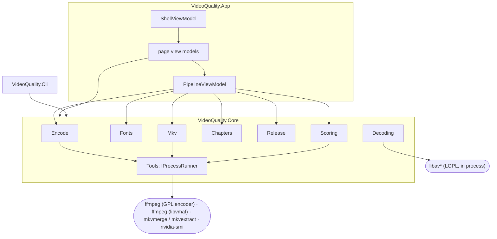
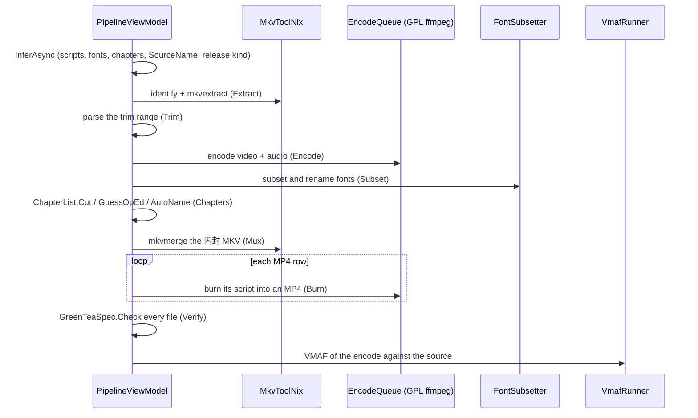

# Architecture

## Projects

```
VideoQuality.Core      no UI; safe to use from tests or other tools
  Scoring/             VmafRunner (ffmpeg process, CUDA/CPU graphs), capabilities, models, progress parser
  Decoding/            FrameDecoder (FFmpeg.AutoGen → BGRA, exact seeks, cache), PacketIndex, FfmpegRuntime
  Imaging/             PixelDiff: difference image + percentile
  Ingest/              DropRouter: incoming paths → reference / encodes / rejected
  Jobs/                Job, JobService: per-kind lanes, cancel, retry
  Encode/              EncodePreset, EncoderCatalog, FfmpegCommandBuilder, EncodeQueue,
                       PresetStore (+ import/export), OnlinePresets (GitHub folders), NvencUhq
  Edit/                TrimMerge: stream-copy and re-encode cuts, mkvmerge/concat joins
  Fonts/               ASS parsing, font catalog and matching, HarfBuzz subsetting, renaming
  Chapters/            ChapterList: OGM/XML/ffmetadata, AutoName, GuessOpEd, Cut, checks
  Mkv/                 MkvToolNix (identify, extract, mux), SubtitleNaming
  Media/               MediaInfo from ffprobe
  Release/             ReleaseName, SourceName (titles and episodes from file names), GreenTeaSpec (rules + checker)
  Monitor/             SystemMonitor: CPU, memory, NVIDIA GPU
  Tools/               IProcessRunner (start, stream, suspend/resume, cancel), EncoderTool, FileSystem
  Localization/        Loc + en.json / zh-Hans.json

VideoQuality.App       Avalonia 12 desktop UI on Semi.Avalonia + Ursa, Fluent System Icons
  ViewModels/          ShellViewModel (navigation) and one view model per page: Main (Compare), MediaInfo,
                       Extract, Encode (+ PresetEditor), TrimMerge, FontSubset, Chapters, Mux, Naming,
                       Pipeline, Monitor, Settings
  Views/               one view per page, MainWindow (rail + page host), SplashView
  Controls/            FrameView, WipeView, Sparkline, Spinner
  Services/            AppServices (process, settings, environment seams), PageIo (pickers), ToastHost
  Styles/              Tokens.axaml (spacing, radii, palette), Layers.axaml (layers, forms, motion)

VideoQuality.Cli       probe / score / frame / diag / subset, no UI
```



GPL tools only ever run as separate processes through `IProcessRunner`; the app links only the LGPL
libav for decoding.

## Data flow (Compare)

```mermaid
flowchart LR
    ref[reference] --> FD[FrameDecoder] --> bgra[BGRA frames] --> WB[WriteableBitmap] --> view[FrameView / WipeView]
    enc[encode] --> FD
    enc --> PI[PacketIndex] --> entry[EncodeEntry] --> table[encode table]
    ref & enc --> VR[VmafRunner] --> log[JSON log] --> rep[VmafReport] --> graph[graph + stats]
    VR -. runs .-> ff(["ffmpeg (libvmaf_cuda preferred)"])
    vp[ViewportState] -. zoom/pan .-> view
```

## The pipeline run

`PipelineViewModel.RunAsync` runs the steps in order. Each `PipelineStep` has a key, an `Enabled`
switch and a state; its settings are view-model properties shown on the step's card. Encodes go
through the shared `EncodeQueue`, so they show on Encode and Monitor too.



## Threading

- The UI thread owns all Avalonia objects, including `WriteableBitmap`s.
- Decoding happens on the thread pool. One `SemaphoreSlim` serialises frame requests because a
  `FrameDecoder` is not thread safe; within a request the reference and encode decoders run
  concurrently, and the difference image is built on the same background task.
- Each pane presents through a `BitmapSwapChain`: two `WriteableBitmap`s reused alternately, so
  playback copies into existing bitmaps instead of allocating new native ones every frame.
- Each frame request increments `_loadVersion`; results from a stale request are discarded, so rapid
  slider movement cannot show an out-of-order frame.
- Scoring is async: the ffmpeg process writes progress to stdout, which is parsed on a background
  task; the UI updates through `IProgress<VmafProgress>`.
- Playback uses a `DispatcherTimer` plus a `Stopwatch`: the target frame is computed from elapsed
  time, so a slow decode drops frames rather than slowing playback.

## Decoding

`FfmpegRuntime` resolves a directory containing the soname the bindings expect
(`libavcodec.so.63` for FFmpeg 9), checks the loaded major against `ExpectedAvcodecMajor`, and refuses
to continue on a mismatch.

`FrameDecoder` opens the file, picks the best video stream, and converts frames to BGRA through
swscale into a reused context.

Seeking is exact for constant-frame-rate files:

1. Seek to the keyframe at or before the target PTS (`avformat_seek_file` + `AVSEEK_FLAG_BACKWARD`).
2. Decode forward, deriving the frame index from `best_effort_timestamp × time_base × fps`.
3. Return the first frame at or after the target index.

An LRU cache sized by a 192 MB budget (24 frames at 1080p, clamped to 4–64) makes stepping cheap; a
forward jump of more than 240 frames re-seeks. Frames are cached under their **actual** decoded index
so a timestamp that overshoots cannot poison the cache.

Two things keep the keyframe walk short:

- **Backward steps keep a window.** A short backward step that has to re-seek also converts and
  caches the frames just before the target (half the cache), so the next left-arrow presses are hits.
  Long backward jumps (scrubbing) skip this.
- **Unseen non-reference frames are skipped.** While walking to the target, packets whose frame is
  before the requested range are sent with `skip_frame = AVDISCARD_NONREF`. Reference frames are
  still decoded, so the target is bit-identical (an integration test compares against a fresh
  decode).

`VideoInfo` also carries pixel format, bit depth, colour matrix/range, and whether the codec is lossy
(H.264/HEVC/AV1 versus FFV1/rawvideo/…).

## Packet index

`PacketIndex.Build(path)` demuxes without decoding and records `(pts, dts, size, keyframe)` for every
video packet. The app uses it for:

- **True video bitrate** — sum of video packet sizes ÷ video duration, excluding audio and container
  overhead. The file-size estimate is only a fallback.
- **Frame count cross-check** — packet count versus the decoded/container count.
- **Keyframe positions** — currently unused by the UI; the data is there for I-frame markers and a
  bitrate trace.

## Colour

The pane header shows the declared matrix and range, and a mismatch between reference and encode
raises a warning. `FrameDecoder` still converts YUV→RGB with swscale's default matrix, which is the
one known correctness gap: the warning tells you when it matters, but the conversion is not yet
matrix-aware.

## Jobs

`VideoQuality.Core/Jobs` holds the UI-independent job model. A `Job` has a title, kind, optional
subject, a work factory (`(job, progress, token) => Task`), a `CancellationTokenSource`, and
observable state/progress/detail/error/elapsed. `JobService` enqueues jobs into per-kind lanes:
scoring runs `scoreConcurrency` at a time (one by default), indexing may run two at a time alongside a
score, exports are serialised. `Cancel` works both queued and running; `Retry` creates a fresh job
from the same factory.

The UI runs every encode through it. `MainViewModel.ProcessEncodeAsync` enqueues an index job
(probe + packet index), then a score job, and mirrors each stage onto the row's `EncodeState`
(queued → indexing → scoring → done / failed / cancelled; stale after a reference change; waiting
when there is no reference yet). The app creates the service with a score lane two wide, because two
CUDA runs overlap well; a CPU run also takes a one-slot gate, so CPU scores stay serial. The status
bar summarises all rows, and Cancel cancels every queued and running job.

## Ingest

`DropRouter.Plan(paths, zone, currentReference, currentEncodes)` is pure apart from reading the file
system: it expands folders, rejects non-video, missing and non-local paths with a reason, drops
duplicates, and decides the reference and the encodes. It also says whether replacing the
reference needs confirmation and whether a reference-zone drop overflowed into encodes (the Undo
case). Drop zones, file pickers, paste, startup arguments and Open With all call
`MainViewModel.HandleDropAsync`, which applies the plan. Drag and drop cannot be driven under Xvfb, so
the router's unit tests are the test path for these rules.

## Where to extend

- A second metric (PSNR/SSIM/CAMBI) can be added to the same filter graph and parsed from the same
  libvmaf JSON.
- Keyframe markers and a bitrate trace have their data ready in `PacketIndex`.
- Worst-frames navigation only needs a sorted view over `VmafReport.Frames`.
- The job/logging model would wrap `ScoreEntryAsync`, `PacketIndex.Build` and future exports.
