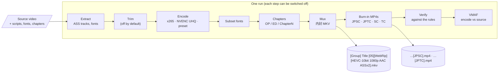
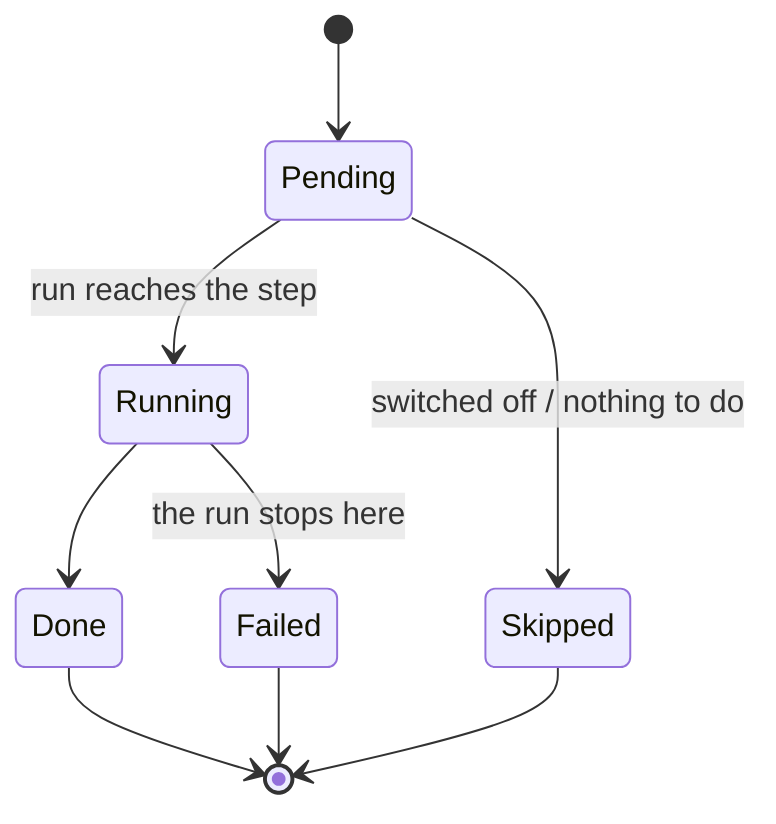

# Release pipeline

The **Pipeline** page takes one episode from its source to a finished release in a single run. It
uses the same code as the separate tool pages (Extract, Trim & Merge, Encode, Font Subset, Chapters,
Mux, Naming), as steps you can switch off and set up one by one. With the defaults, one run makes a
complete anime release by the group's rules.



## Dropping a source

Drop the video (or pick it) and the page fills itself in:

| What | Where it comes from |
|---|---|
| Scripts | `.ass`/`.ssa` files beside the video whose names start with the video's name (`Show 05 JPSC.ass`) |
| Font folder | a `Fonts`, `fonts` or `字体` folder beside the video |
| Chapter file | `<name>.chapters.xml`, `<name>.xml`, `<name>.chapters.txt` or `chapters.xml` beside it; otherwise the source's own chapters |
| Title, episode, version | the file name: `Title 05`, `[Group] Title - 03v2 (1080p)`, `Title S01E12`, `标题 第05话`, `Title OVA 02`, `Title The Movie` |
| Release kind | BD when the name says BD/BDRip/Blu-ray, or the audio is lossless and the name does not say Web; a movie when the name says so, or it has no episode number and runs over an hour |
| MP4s | one per script, tagged from its name (JPSC, JPTC, SC, TC); a script without a tag gets the first free one |
| Output folder | `release/` beside the source |

A file already named like a release (`[Studio GreenTea] Show [02][BDRip][…].mkv`) fills the Naming
form exactly as named. Everything stays editable; group, source and codecs come from the Naming page.

## Steps and their settings

Every step is a card with an on/off switch and its own settings. A switched-off step is skipped and
dimmed; the rest of the run goes on without it.

| Step | Default | Settings | Notes |
|---|---|---|---|
| **Extract** | on | pull scripts · pull fonts | Only when no scripts (or no font folder) were given, and only from a Matroska source. ASS tracks are named from the track name (`简日` → JPSC). |
| **Trim** | off | from · to | Every encode keeps the range; chapters move with it. VMAF is skipped (a cut does not line up with the full source). |
| **Encode** | on | encoder · preset · quality | x265 10-bit CRF by the rules, NVENC HEVC UHQ (CQ), or the picture settings of any Encode page preset. Audio, frame rate and streams always follow the rules. Off means the source is already encoded. |
| **Subset fonts** | on | font folder | Subsets and renames every font the scripts draw. Off: the MKV carries every font in the folder. |
| **Chapters** | on | chapter file · find OP/ED by song length | Names the marks OP, ED, Chapter1, Chapter2 … OP/ED are found by name, else by length (70–110 s; the first in the first half, the last in the second). Off: the marks are used as they are. |
| **Mux** | on | MKV title · default subtitle | The 内封 MKV: encode, scripts as `zh` JPSC/JPTC/SC/TC tracks, `ja` audio, fonts, chapters. |
| **Burn-in MP4s** | on (web) | the MP4 list · Add MP4 | Each row picks its language tag and the script burned into it. Add as many as you like, from any script. BD releases start with this off. |
| **Verify** | on | stop on failures | Checks every written file against the rules (name, codec, audio, tracks, fonts, chapters, size). Off "stop" lists the problems and goes on. |
| **VMAF** | on | model · backend · reference | Scores the encode against the source (or a reference you give). |



Encodes go through the shared queue, so they also show on the Encode and Monitor pages, with
progress, speed and ETA. When the run finishes, the written files are listed with a reveal button,
and **Open in Compare** loads the encode against its source.

## NVENC UHQ

The **NVENC HEVC UHQ** encoder (also a built-in Encode preset) is `hevc_nvenc -preset p7 -tune uhq
-rc vbr -cq 26.25 -b:v 0 -multipass fullres -maxrate 8000k -bufsize 16000k`, 10-bit. On a 24-minute
1080p anime episode it matched an x265 medium CRF 18 encode's size with a higher VMAF on every
statistic:

| Encode | Size | VMAF NEG | p1 | min | VMAF (standard) |
|---|---:|---:|---:|---:|---:|
| x265 CRF 18, medium | 299.6 MB | 95.10 | 91.18 | 77.0 | 96.15 |
| NVENC UHQ CQ 26.25 | 299.8 MB | **95.31** | **92.19** | **83.6** | **96.38** |

The UHQ tune needs ffmpeg built against NVENC SDK 12.2+ headers and an RTX 40/50 GPU. The app checks
the encoder ffmpeg (`-h encoder=hevc_nvenc`) and falls back to `-tune hq` when UHQ is missing, and says
so on the Encode step. The group's rules require x265, so NVENC is for comparison and private encodes.

## Running it without the window

The same view model drives an opt-in test that runs a real episode end to end and prints each step:

```bash
VQ_E2E_SOURCE="/media/Show 05.mkv" VQ_E2E_OUT=/tmp/release [VQ_E2E_ENCODER=x265] \
  dotnet test VideoQuality.App.Tests --filter EndToEnd --logger "console;verbosity=detailed"
```
